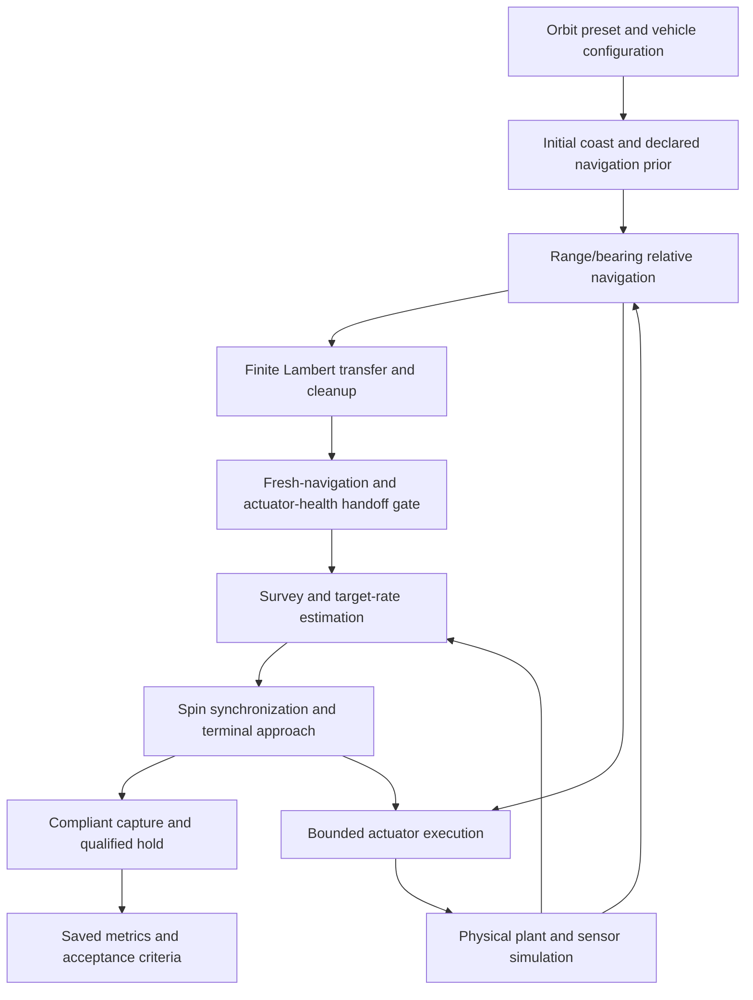

# Unified LEO/GEO Rendezvous, Proximity Operations and Capture

A Python research simulation of a servicing spacecraft approaching and capturing a non-cooperative target, using one shared engine with LEO and GEO orbital presets.

**Purpose of this repository:** provide a compact, inspectable implementation and saved evidence for independent technical review. This is an engineering prototype developed with AI-assisted coding. It is not flight software, a flight-qualified system, a reproduction of a named servicing mission, or evidence of general mission reliability.

## Start here: technical review

1. Read the [single-run results](#saved-single-run-results) and [limitations](#assumptions-and-limitations).
2. Inspect [the shared mission wrapper](mission_specifics/rpod/wrapper.py), [terminal engine](fsw/rpod.py), and [far-leg navigation](estimation/rpod_relative_navigation.py).
3. Run the focused checks below, then inspect the saved [LEO](evidence/leo_seed1/trial_1.json) and [GEO](evidence/geo_seed1/trial_1.json) records.
4. See [validation scope and evidence interpretation](docs/VALIDATION.md).

The most useful feedback would concern physical consistency, estimator assumptions, achieved-versus-commanded actuation, handoff continuity, capture acceptance and missing evidence. No endorsement by Stanford, SLAB, ISRO or any researcher is implied.

## What the simulation does

The default full profile combines:

- Independent nonlinear Cartesian chief/deputy propagation with central gravity and J2; an illustrative plate/effective-area disturbance environment adds drag, solar radiation pressure and gravity-gradient effects.
- A finite-duration Cartesian Lambert transfer, numerical shooting and navigation-driven midcourse replanning, followed by bounded proximity acquisition.
- Relative navigation using range/bearing measurements and ROE/CW filters. The ROE estimate drives far-leg guidance.
- Physical RCS allocation with 16 jets, pulsing, valve behaviour, fuel accounting and geometric plume exclusions; inherited wheel and attitude-chain states continue across handoff.
- A performance-gyro and star-tracker chain feeding an attitude MEKF.
- Pixel-level projection and pose estimation with known target landmarks, plus an illustrative segmented bell-rim ranging/survey abstraction.
- Estimated-state terminal guidance, rate synchronization and approach to a rotating capture fixture.
- Two-body compliant capture dynamics and a five-second qualified capture hold.

These features are implemented models; inclusion alone does not establish their fidelity to flight hardware.



The supervisor qualifies a handoff below 20 m estimated range and 0.15 m/s estimated speed, with fresh navigation, ready actuation, no active burn, and five seconds of qualification. It is not a complete operational abort supervisor.

## Orbit presets and illustrative vehicle

| Setting | LEO | GEO |
|---|---:|---:|
| Chief orbital radius | 6,781 km | 42,164 km |
| Chief inclination | 51.6 degrees | 0 degrees |
| Initial along-track separation | 100 m | 100 m |
| Nominal transfer time | 2,700 s | approximately 41,863.53 s |
| Maximum far-leg window | 4,500 s | 69,773 s after time-grid rounding |
| Terminal time bound | 2,400 s | 2,400 s |

Both presets use the same illustrative vehicle, target and sensor settings. Orbit timing scales with radius to the power 1.5. GEO is an orbital configuration of the shared engine, not a port of every feature in the older GEO implementation.

Selected defaults: chaser dry mass 50 kg, initial propellant 1 kg, diagonal inertia (10, 10, 6) kg m^2, individual jet force 0.25 N, specific impulse 220 s, and target mass 500 kg. Terminal outer step is 0.25 s; far-leg outer step is 0.5 s. The attitude chain substeps at approximately 0.01 s. These are demonstration assumptions, not validated spacecraft specifications.

## Saved single-run results

The following are **two historical full runs, one seed per orbit**, recovered from their original frozen snapshots. Both saved results have no execution error, `far_handoff=true`, `terminal_capture=true`, and all eight terminal criteria true. They are not a Monte Carlo success-rate estimate.

| Saved measurement | LEO, seed 1 | GEO, seed 1 |
|---|---:|---:|
| Declared mission result | PASS | PASS |
| Reported elapsed simulation time | 3,398.50 s | 39,047.25 s |
| Terminal phase duration | 1,076.00 s | 1,161.25 s |
| Recorded total delta-v diagnostic | 1.276012 m/s | 1.393635 m/s |
| Terminal propellant consumption | 0.042831 kg | 0.048990 kg |
| Final relative-position estimation error | 1.428 mm | 2.122 mm |
| Final fixture axial error | 0.558 mm | 1.130 mm |
| Final fixture lateral error | 2.443 mm | 0.488 mm |
| Final fixture-relative speed | 0.01435 mm/s | 0.01806 mm/s |
| Final alignment error | 0.04075 degrees | 0.01061 degrees |
| Qualified capture hold | 5.0 s | 5.0 s |
| Peak modelled contact load | 0.01767 N | 0.01729 N |
| Minimum recorded bus-sphere clearance diagnostic | 0.20709 m | 0.20773 m |
| Bus collision / attachment overload | Neither reported | Neither reported |

Final contact errors are evaluated after compliant attachment and the hold; they are not all pre-contact approach errors. The report's elapsed time excludes the initial 30 s coast: the final truth clocks are 3,428.50 s and 39,077.25 s. Delta-v is the implementation's cumulative translational diagnostic, not a propulsion-optimality claim or a complete six-axis impulse budget.

Read the original records, including pre-capture metrics and mode transitions:

- [LEO seed-1 record](evidence/leo_seed1/trial_1.json) and [provenance/source comparison](evidence/leo_seed1/provenance.json).
- [GEO seed-1 record](evidence/geo_seed1/trial_1.json) and [provenance/source comparison](evidence/geo_seed1/provenance.json).
- [Machine-readable comparison](evidence/single_run_summary.json).

**Important source distinction:** these runs predate extraction of this smaller package. The core engine, dynamics, navigation and control files match the original run snapshots byte-for-byte; seven shared export/factory/report files were narrowed during packaging. This extracted tree has focused checks and bounded initialization/stepping evidence; it has not received a fresh full end-to-end replay. The exact matched/changed/added files are recorded in each provenance file.

A separate 300-trial campaign was launched locally (150 seeds per orbit). It is not presented here as completed evidence, and its large source archives and live logs are not included.

## Acceptance criteria

The outer report requires both a qualified far-to-terminal handoff and terminal success. Terminal success requires all of:

1. Completed capture with at least five seconds of qualified hold.
2. Recorded capture-entry evidence.
3. No sampled bus collision.
4. No modelled attachment overload/breakage.
5. Actuator-health readiness.
6. Healthy measured-attitude chain.
7. At least one accepted mapped-pixel pose.
8. Engaged physical attachment.

The local geometric contact gate uses axial error in [0, 0.04) m, lateral error below 0.04 m, relative speed below 0.01 m/s, alignment below 2 degrees, and spin-rate error below 0.1 degrees/s. See `eligible()` and `RPODMission.summary()` in [fsw/rpod.py](fsw/rpod.py). A zero process exit is not mission acceptance.

The saved `far.rdv_success=false` flag is retained in both historical records. It belongs to a separate legacy far-leg truth-based endpoint/hold evaluator; it is not the shared supervisor's handoff criterion. The top-level handoff and terminal results are reported explicitly rather than hiding this distinction. Also, the far summary is generated after terminal execution on a shared plant, so its final range must not be interpreted as the far-leg handoff range.

## Install and run

Python 3.11 is the locally checked interpreter. The pinned packages reproduce the recorded local environment; availability on other Python versions/platforms has not been established. No model weights or LLM are required.

```bash
python -m venv .venv
# Activate .venv for your shell, then:
python -m pip install -r requirements.txt
python main.py --describe
```

On Windows, `py -3.11` can replace `python` when selecting the interpreter.

Single full runs (use a fresh output directory each time):

```bash
python main.py --profile full --parameters configs/rpod_leo.json --seed 1 --duration 2400 --output results/leo_seed1
python main.py --profile full --parameters configs/rpod_geo.json --seed 1 --duration 2400 --output results/geo_seed1
```

`--duration` bounds the terminal phase, not total mission time. Full GEO runs can be slow. The far leg ends on qualified handoff or its separate time bound. The `terminal-window` profile is a fresh terminal-only diagnostic and does not reproduce a complete far-leg handoff.

Monte Carlo, one worker, one orbit at a time:

```bash
python mc.py --profile full --parameters configs/rpod_leo.json --runs 150 --workers 1 --seed 0 --duration 2400 --output results/leo_mc
python mc.py --profile full --parameters configs/rpod_geo.json --runs 150 --workers 1 --seed 0 --duration 2400 --output results/geo_mc
```

Seeds vary the existing stochastic models and declared initial variations; they do not imply a comprehensive hardware/environment dispersion campaign. For interrupted campaigns, use the identical source/configuration and append `--resume`; completed trial records are retained and interrupted trials restart in separate attempt folders. Do not run duplicate workers against the same output folder. There is no automatic retry policy.

## Focused verification

```bash
python -m unittest -v tests.test_unified_rpod tests.test_rpod_rim_covariance
```

These 11 component checks cover orbit initialization/configuration, handoff inhibition and dwell, the legacy alias, rim covariance/bias-floor handling, inconsistent geometry, freshness and invalid covariance. They do not cover the entire closed loop.

`python verify_package.py` additionally runs short far-leg and terminal stepping in both orbits and checks local import isolation. These intentionally short cases do not meet mission acceptance; a normal execution with `success=false` is expected. It creates a local `BOUNDED_VERIFICATION.json`.

## Code map

| Path | Responsibility |
|---|---|
| `main.py`, `mc.py`, `wrapper.py` | Public entry points for the same shared simulation |
| `mission_specifics/master_rpod/wrapper.py` | Select full mission or terminal diagnostic |
| `mission_specifics/rpod/wrapper.py` | Orbit configuration, far-to-terminal orchestration and report |
| `fsw/rpod.py`, `fsw/rpod_supervisor.py` | Terminal state machine, capture and handoff qualification |
| `fsw/leo_attitude.py` | Shared attitude sensing/MEKF chain; historical filename also used for GEO |
| `estimation/` | Relative navigation, attitude filtering and camera-pose solution |
| `control/` | Lambert planning, finite burns, rendezvous and attitude control |
| `sensors/` | Range/bearing, gyro, star tracker and landmark camera |
| `actuators/` | RCS allocation/execution, valve and wheel support |
| `plant/`, `environment/` | Coupled rigid bodies, contact, orbit and disturbances |
| `spec/`, `utils/` | Typed records, time, frames, numerical helpers |
| `telemetry/` | Trial records, provenance, optional diagnostics |
| `tests/`, `evidence/`, `docs/` | Focused checks, saved results and review notes |

Shared files may retain helper functions unused by this scenario. Other mission implementations, AI-training assets and the previous broad library are not included.

## Frames and interfaces

The terminal engine expresses relative position and coordinate-derivative velocity in chief RTN/LVLH axes, with rotation matrices mapping body vectors into that frame. Cartesian truth is propagated in inertial coordinates. Transformations include rotating-frame terms; see [utils/orbital_frames.py](utils/orbital_frames.py). SI units are used unless a field explicitly names another unit. Quaternion conventions and time/measurement records are defined by the code in `utils/` and `spec/`; review them before connecting another simulator.

## Assumptions and limitations

- Chief ephemeris is assumed known. Far navigation starts with a one-time noisy truth-derived prior, not autonomous target discovery or absolute navigation.
- Landmark geometry/correspondences are supplied to the camera model. There is no demonstrated raw-image detection pipeline, unknown-target reconstruction or CNN pose estimator in this package.
- The bell-rim sensor and uncertainty treatment are illustrative. No hardware-derived sensor calibration or full joint pose/geometry uncertainty validation is established.
- Target geometry, actuator settings and contact properties are illustrative, not identified from a flight vehicle. There is no demonstrated telemetry-based digital twin or learned physics surrogate here.
- The environment is simplified. Neither comprehensive GEO force modelling nor long-duration high-precision orbit truth has been independently validated.
- Collision checks sample example bus geometry at plant steps and exclude appendages. Geometric plume exclusion is not a plume-fluid or contamination model.
- Physics truth is used for measurement generation, independent scoring/contact mechanics and some simulation safety stops; the entire Python program is not an onboard-information-only implementation.
- The handoff supervisor does not establish complete safe abort/retreat trajectories under combined failures.
- Finite-step contact behaviour, estimator consistency, filter noise calibration and closed-loop robustness need further independent assessment.
- No embedded execution timing, hardware-in-the-loop qualification, mission certification, global stability proof or comprehensive reliability percentage is claimed.

## Questions for an independent reviewer

1. Are the frame conventions, propagation and far-to-terminal state/hardware continuity physically consistent?
2. Are the navigation priors, sensing abstractions and covariance assumptions sufficient for the claimed scenario?
3. Does achieved actuation accurately represent the bounds and nonidealities relevant to this demonstration?
4. Are capture entry/hold, collision and load criteria appropriate, and what important checks are missing?
5. Which independent benchmarks and failure cases should be completed before treating this as a useful engineering tool?

The repository name is retained for continuity. The earlier GEO-only implementation and its historical claims remain available in Git history; they are not evidence for the replacement tree.
